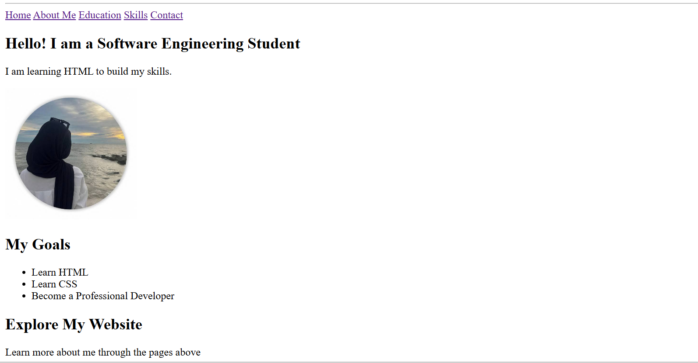
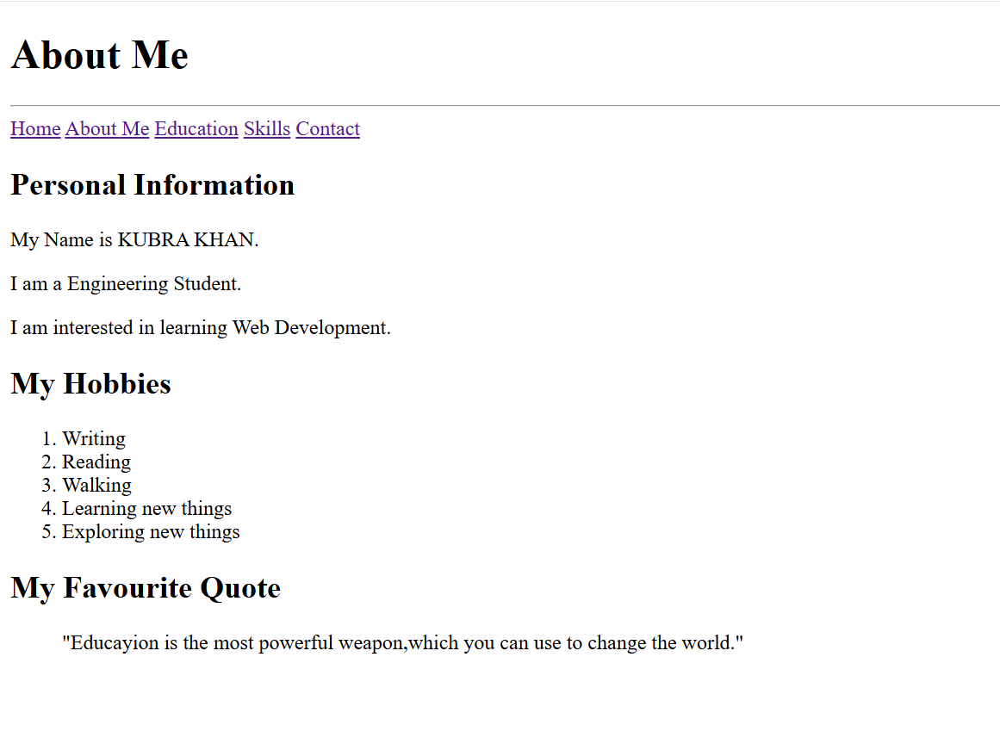
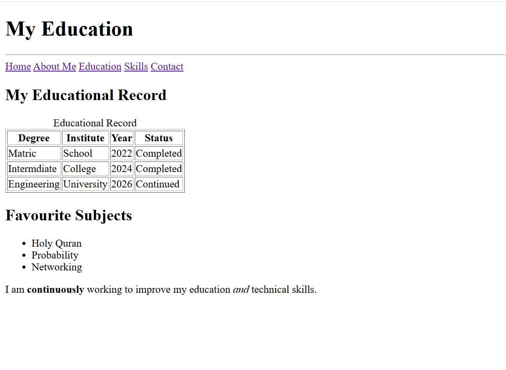
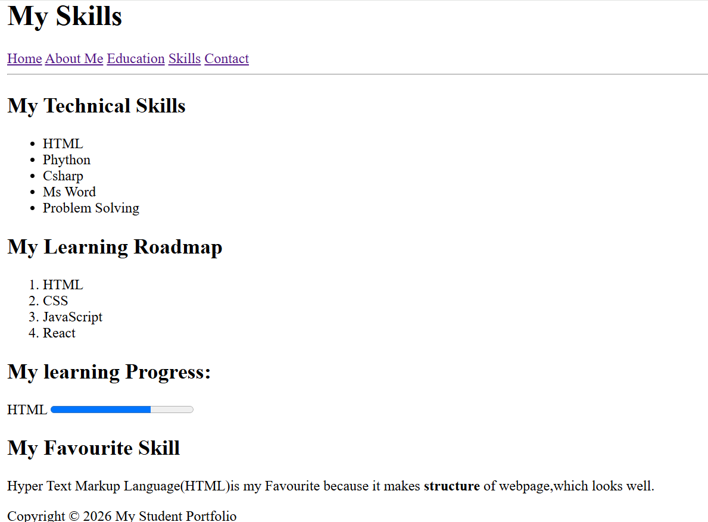
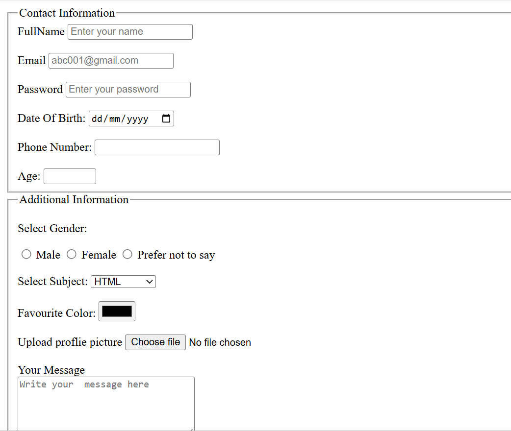

# Student Portfolio Website

# About the Project

This is my first HTML project. I created a simple Student Portfolio Website using only HTML.

The purpose of this project is to practice HTML concepts from basic to intermediate level.

# Pages Included

1. Home Page
2. About Me
3. Education
4. Skills
5. Contact

# Technologies Used

- HTML5

Note: This project is created using HTML only. No CSS or JavaScript is used.

# Screenshots
# Home

# About me

# Education

# Skill

# Contact

# HTML Topics Covered

- HTML Basic Structure
- Headings and Paragraphs
- Text Formatting
- Ordered and Unordered Lists
- Images
- Hyperlinks
- Tables
- Semantic HTML Elements
- Navigation Links
- Multiple HTML Pages
- File Paths

# How to Run

1. Download or clone this repository.
2. Open the project folder.
3. Open "index.html" in your web browser.

# Project Purpose

This project is created for learning and practicing HTML. It helped me understand how to structure a multi-page website using HTML.

# Author
Created by: KUBRA KHAN
